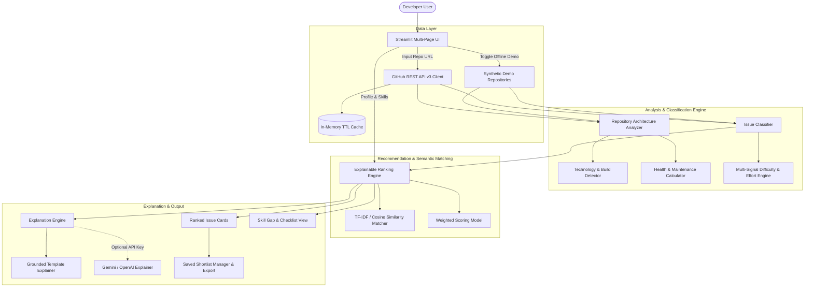

# 🧭 OpenSource Compass — AI Open-Source Contribution Finder

> **Find your first issue. Make your first contribution.**

[](https://github.com/suhaasvooturi/ai-open-source-contribution-finder/actions/workflows/tests.yml)
[](LICENSE)
[](https://www.python.org/downloads/)
[](https://streamlit.io)

OpenSource Compass is an AI-assisted developer intelligence platform designed to eliminate the friction, hesitation, and guesswork of open-source software contributions. Instead of sifting endlessly through thousands of unstructured GitHub issues, developers can discover personalized, ranked, and explainable contribution opportunities calibrated to their skills, experience level, and learning goals.

---

## 📌 Problem Statement

Starting out in open source is notoriously intimidating:
- **Search Fatigue:** Developers struggle to find relevant beginner-friendly issues amidst thousands of active tickets.
- **Mislabeled Issues:** Tags like `good first issue` are often stale, abandoned, or secretly require complex architectural overhauls.
- **Skill Uncertainty:** Contributors often don't know if they possess the requisite tools, tests, and domain background to solve an issue before investing hours of setup.
- **Setup Ambiguity:** Navigating disparate contribution guidelines, testing procedures, and local build steps without clear mentorship causes high abandonment rates.

**OpenSource Compass solves this** by analyzing repository architecture, classifying issue complexity using multi-signal heuristics, calculating transparent compatibility scores, and generating actionable preparation checklists.

---

## ✨ Features

- 🎯 **Explainable Match Scoring:** Multi-factor weighted compatibility model factoring skill overlap (30%), experience fit (25%), learning goals (20%), maintainer tags (15%), and semantic similarity (10%).
- 🏷️ **Multi-Signal Difficulty Classification:** Evaluates issues into *Beginner*, *Intermediate*, *Advanced*, or *Difficulty uncertain* based on title keywords, labels, code snippets, checklists, and body semantics.
- ⏱️ **Effort Estimation:** Provides realistic effort ranges (e.g. 1-3 hours, 3-8 hours) with transparent explanations.
- 🔍 **Interactive Issue Explorer:** Filter by language, labels, difficulty, and effort; search title/body texts; switch between rich card and tabular views.
- 🏛️ **Repository Architecture Analyzer:** Inspects detected frameworks, build systems (`pyproject.toml`, `package.json`, `Cargo.toml`), test directories, and calculates health scores.
- 📖 **Contribution Guide Reader:** Automatically parses `CONTRIBUTING.md` / `README.md` to extract setup commands, test suites, linter commands, and PR expectations.
- 📈 **Skill Gap Analyzer:** Maps developer skills against issue requirements, identifies missing dependencies, and generates concrete learning checklists.
- ⭐ **Saved Shortlist:** Curate bookmarked issues locally in session state and export directly to **JSON** or **CSV**.
- 🧪 **100% Offline Demo Mode:** Includes realistic synthetic repositories (`demo/fastapi-taskflow`, `demo/react-metricshub`, `demo/scikit-mlpipe`) for instant evaluation without network access or GitHub API rate limits.
- 🤖 **Provider-Independent AI Mentorship:** Ships with a grounded, deterministic template explanation engine (zero API keys needed) and optional plug-and-play support for Google Gemini or OpenAI.

---

## 🏗️ Architecture Overview



---

## 📐 Recommendation Scoring Formula

Recommendations are ranked according to a transparent weighted model normalized strictly to `[0.0, 1.0]` (0% to 100%):

$$\text{Match Score} = w_{\text{skill}} \cdot S_{\text{skill}} + w_{\text{exp}} \cdot S_{\text{exp}} + w_{\text{goals}} \cdot S_{\text{goals}} + w_{\text{label}} \cdot S_{\text{label}} + w_{\text{semantic}} \cdot S_{\text{semantic}}$$

| Component | Default Weight | Description |
| :--- | :--- | :--- |
| **$S_{\text{skill}}$ (Skill Overlap)** | **30%** | Jaccard overlap between user skills and technologies required by the issue / repo. |
| **$S_{\text{exp}}$ (Experience Fit)** | **25%** | Compatibility between developer experience level and estimated issue difficulty. |
| **$S_{\text{goals}}$ (Learning Goals)** | **20%** | Degree to which the issue provides practice in user's target goals. |
| **$S_{\text{label}}$ (Friendly Labels)** | **15%** | Boost for newcomer tags (`good first issue`, `documentation`, `help wanted`). |
| **$S_{\text{semantic}}$ (Semantic Similarity)** | **10%** | TF-IDF / Cosine similarity between developer profile vector and issue text. |

> **Disclaimer:** A match score represents **profile compatibility and contextual fit**. It is **not** a mathematical probability of pull-request merge success. Maintainer review processes and code quality standards apply.

---

## 🚀 Installation & Getting Started

### Prerequisites
- Python 3.11 or Python 3.12
- Git

### 1. Clone the Repository
```bash
git clone https://github.com/suhaasvooturi/ai-open-source-contribution-finder.git
cd ai-open-source-contribution-finder
```

### 2. Set Up Virtual Environment

**On Windows (PowerShell):**
```powershell
python -m venv .venv
.\.venv\Scripts\Activate.ps1
```

**On Linux / macOS:**
```bash
python3 -m venv .venv
source .venv/bin/activate
```

### 3. Install Dependencies
```bash
pip install -r requirements.txt -r requirements-dev.txt
```

### 4. Configuration (Optional)
Copy `.env.example` to `.env`:
```bash
cp .env.example .env
```
Available environment variables:
- `GITHUB_TOKEN`: Personal Access Token to raise GitHub API rate limits from 60 to 5,000 requests/hour. (Public read-only, no scopes required).
- `LLM_PROVIDER`: `gemini` or `openai` (Optional; defaults to built-in template engine).
- `LLM_API_KEY`: API key for Gemini or OpenAI.

---

## 🖥️ Running the Application

Launch the Streamlit web dashboard:
```bash
streamlit run app.py
```
Open your browser at `http://localhost:8501`.

---

## 🧪 Running Automated Tests

Run the complete test suite with `pytest`:
```bash
pytest tests/ -v
```

### Test Coverage Highlights:
- ✅ GitHub URL parsing (standard URLs, slugs, `.git`, trailing slashes, invalid domains).
- ✅ GitHub client error handling (404 Not Found, 403 Rate Limits, network timeouts).
- ✅ Filtering pull requests out of GitHub issues.
- ✅ Technology detection & alias normalization (`py` -> `Python`, `js` -> `JavaScript`, etc.).
- ✅ Multi-signal issue classification across Beginner, Intermediate, Advanced, and Uncertain.
- ✅ Scoring bounds `[0.0, 1.0]` and configurable weight normalization.
- ✅ Grounded explanation generation and unconfigured LLM fallback.
- ✅ Saved shortlist CRUD operations and JSON/CSV data export.
- ✅ Complete offline synthetic demo repository validation.

---

## 🌐 Deploying to Streamlit Community Cloud

OpenSource Compass is fully compatible with Streamlit Community Cloud:

1. Push your repository to GitHub: `https://github.com/suhaasvooturi/ai-open-source-contribution-finder`.
2. Visit [share.streamlit.io](https://share.streamlit.io/) and click **New App**.
3. Select your repository, branch (`main`), and set the main file path to `app.py`.
4. In **Advanced Settings**, add any optional secrets (`GITHUB_TOKEN` or `LLM_API_KEY`).
5. Click **Deploy**!

---

## 🛡️ Responsible Use & Security Ethics

- **Public Read-Only Access:** Only inspects public repository metadata and issue tickets via standard GitHub REST endpoints.
- **Zero Credential Collection:** Never asks for or stores user GitHub passwords.
- **Prompt Sandboxing:** All retrieved GitHub issue bodies and README text are treated as untrusted input. Prompts isolate untrusted text to prevent prompt injection, and the app never executes shell commands or instructions found within issues.
- **Honest Uncertainty:** When issue text has insufficient detail (< 5 words, no labels), difficulty is reported as `Difficulty uncertain` rather than fabricating confidence.

---

## 🗺️ Project Roadmap

- [x] Multi-signal difficulty heuristics and effort range estimation
- [x] Explainable weighted scoring model with TF-IDF semantic similarity
- [x] Contribution Guide reader for setup/testing/PR extraction
- [x] Saved Shortlist with JSON and CSV exports
- [x] 100% offline synthetic demonstration mode
- [x] Provider-independent LLM explanation adapter (Gemini / OpenAI)
- [ ] Add GraphQL GitHub API client for batch issue queries
- [ ] Good-first-issue maintainer response time metrics
- [ ] Multi-repository contributor track exploration

---

## 📄 License

This project is licensed under the MIT License - see the [LICENSE](LICENSE) file for details.

Copyright (c) 2026 **Suhaas Vooturi**
